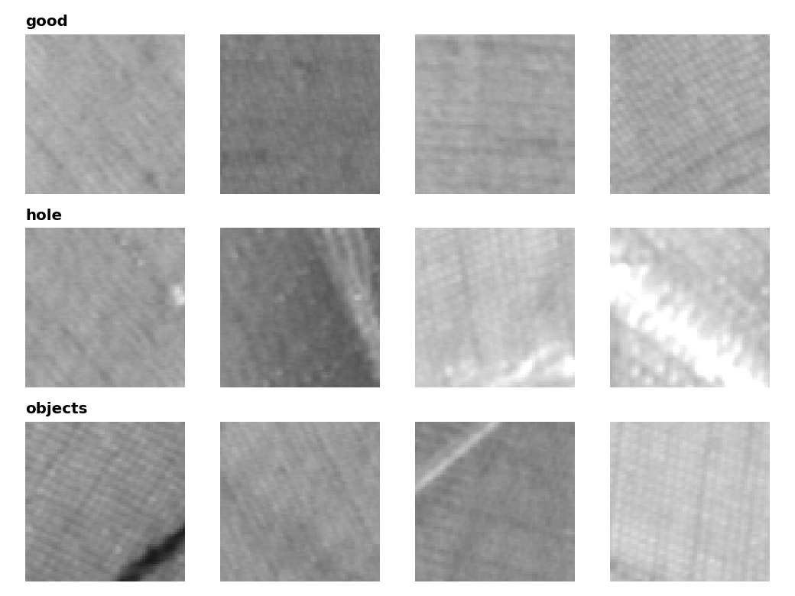
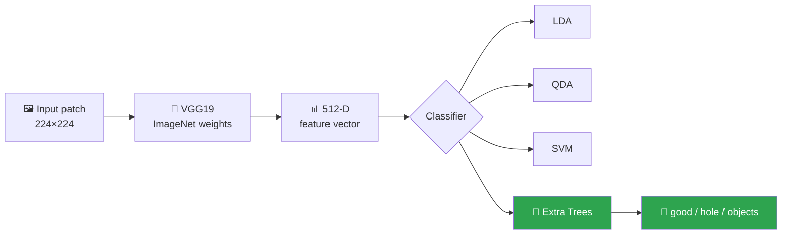
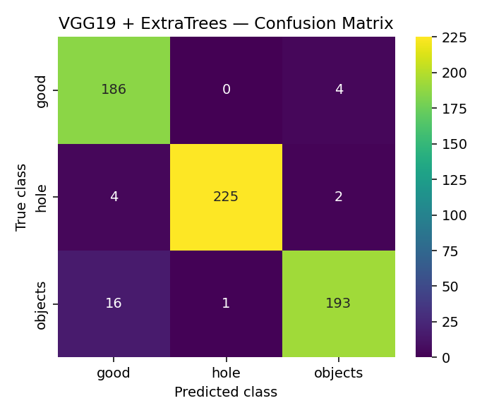

<div align="center">

# 🧵 Multi-Class Texture Classification

### Patch-Level Texture Classification Using Transfer Learning on **TILDA-400**

*VGG19 deep features + Extra Trees = **95.7% accuracy** across 3 texture classes*

<p>
  
  
  
  
</p>
<p>
  
  
  
  
</p>

**B4 · AIML · 2022 – 2026**

</div>

---

## ✨ Highlights

- 🧠 **Transfer learning:** a pretrained **VGG19** (ImageNet) turns each image into a 512-dimensional feature vector, with no deep network training needed.
- 🌲 **Proposed model:** an **Extra Trees** classifier on top of the VGG19 features beats the LDA, QDA and SVM baselines by a wide margin.
- 🖥️ **Point-and-click GUI:** load the data, extract features, train, evaluate and predict from one Tkinter window.
- ⚡ **Fast to demo:** cached features and trained models are included, so there's no hours-long extraction step.

## 🖼️ Dataset: TILDA-400

Texture patches in three classes:

| Class | Images | What it is |
|:--|--:|:--|
| ✅ `good` | 1,001 | Defect-free texture |
| 🕳️ `hole` | 1,101 | Texture with a hole defect |
| 📦 `objects` | 1,049 | Texture with foreign objects |
| | **3,151** | |

<div align="center">
  
  <br><sub>Sample patches from each class</sub>
</div>

## 🔬 Pipeline



1. **Feature extraction:** images are resized to 224×224, preprocessed, and passed through VGG19 (no top layer, average pooling).
2. **Split:** 80% train / 20% test (`random_state=42`). The shuffle order is saved in `model/shuffled_indices.npy` so results are reproducible.
3. **Classification:** four classifiers are compared. Extra Trees (200 trees, max depth 32) is the proposed model.
4. **Evaluation:** accuracy, macro precision, recall and F1, a classification report and a confusion matrix.

## 📈 Results

Evaluated on the held-out test set (631 images):

| Model | Accuracy | Precision | Recall | F1-Score |
|:--|:-:|:-:|:-:|:-:|
| LDA *(existing)* | 86.05% | 86.06% | 86.14% | 85.86% |
| QDA *(existing)* | 37.72% | 44.94% | 37.37% | 24.43% |
| SVM (RBF) | 76.07% | 77.99% | 76.89% | 75.97% |
| **🏆 VGG19 + Extra Trees *(proposed)*** | **95.72%** | **95.61%** | **95.73%** | **95.59%** |

<div align="center">
  
  <br><sub>Confusion matrix for the proposed VGG19 + Extra Trees model</sub>
</div>

<details>
<summary><b>Per-class report (VGG19 + Extra Trees)</b></summary>

| Class | Precision | Recall | F1-Score | Support |
|:--|:-:|:-:|:-:|:-:|
| good | 0.90 | 0.98 | 0.94 | 190 |
| hole | 1.00 | 0.97 | 0.98 | 231 |
| objects | 0.97 | 0.92 | 0.94 | 210 |

</details>

> Metrics are on the 20% hold-out split. Re-running the app on a different machine or library version may change them slightly.

## 🚀 Getting Started

### 1. Install dependencies

```bash
pip install tensorflow scikit-learn numpy pandas scipy opencv-python scikit-image matplotlib seaborn pillow joblib
```

> The first run downloads the VGG19 ImageNet weights, so you need an internet connection once.

### 2. Run the app

```bash
python Main.py
```

On Windows you can also double-click **`run.bat`**.

### 3. Use the GUI

| Step | Button | What it does |
|:-:|:--|:--|
| 1 | **Upload Dataset** | Select the `TILDA` folder |
| 2 | **VGG19 Feature extraction** | Loads cached features, or extracts them if missing |
| 3 | **Train Test Splitting** | Creates the 80/20 split |
| 4 | **Existing LDA / QDA**, **Train SVM / ETC** | Evaluates each model and shows its confusion matrix |
| 5 | **Upload test image** | Classifies any single image with the ETC model |
| 6 | **Exit** | Closes the app |

> 💡 Saved models in `model/` are loaded instead of retrained. Delete a `.pkl` file to retrain that model.

## 📁 Project Structure

```
.
├── Main.py                   # GUI app: extraction, training, evaluation, prediction
├── run.bat                   # Windows launcher
├── background.jpg            # GUI background
├── TILDA/                    # Dataset: good / hole / objects
├── model/
│   ├── X_compressed.npz      # Cached VGG19 features
│   ├── Y.npy                 # Cached labels
│   ├── shuffled_indices.npy  # Saved shuffle order
│   └── *_model.pkl           # Trained LDA, QDA, SVM, ETC (and XGB, unused by the GUI)
├── assets/                   # README images
├── FINAL DOCUMENTATION.pdf   # Full project report
└── PPT.pdf                   # Presentation
```

## 📚 Documentation

- 📄 [Final Documentation (PDF)](FINAL%20DOCUMENTATION.pdf)
- 🎞️ [Presentation (PDF)](PPT.pdf)

---

<div align="center">

⭐ If you found this project useful, consider giving it a star!

</div>
